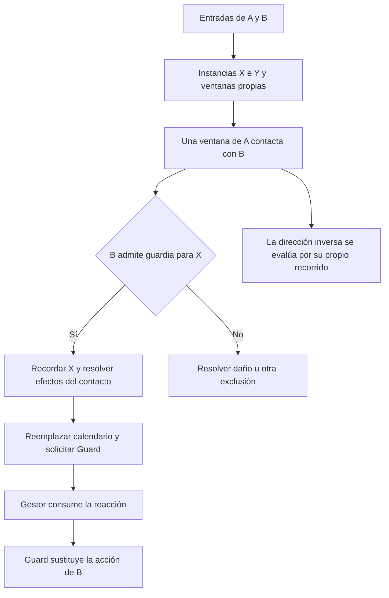
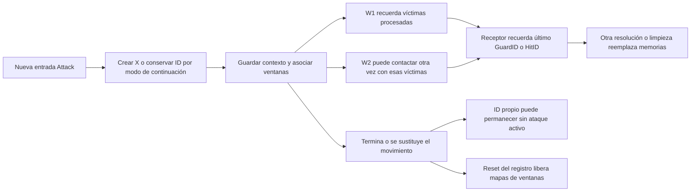

# FGO Arcade como referencia práctica para Vamps

Revisión del 18 de octubre de 2026. Cruza los cuatro videos originales, las tres fases de investigación del ejecutable y el código actual de Vamps. [Videos y trazas](evidencia.md), [resultado de la revisión](reporte.md) y [comprobaciones del editor](editor.md).

**La base de Vamps sirve. La siguiente pieza que necesita es una reacción defensiva con identidad, tiempo y permisos propios.** GAS, el resolver de contactos, las trazas de armas y los datos por paso permiten construirla. El código actual todavía representa el bloqueo principalmente como consumir una disponibilidad y restringir ofensiva; eso no reproduce el recorrido completo encontrado en FGOA.

Esta guía distingue la referencia original de las adaptaciones anteriores de Vamps. No cambia las especificaciones de producto ni el gameplay. Tomar FGOA como objetivo de fidelidad exige revisar algunas de aquellas adaptaciones, pero no convierte las decisiones previas del prototipo en errores de implementación.

Para seguir con el desarrollo: [evaluación del código](#10-evaluación-concreta-del-código-actual-de-vamps), [supuestos corregidos](#11-supuestos-que-hay-que-corregir-o-separar) y [próxima unidad de implementación](#12-dirección-recomendada-para-implementarlo-con-código-propio).

## Cómo leer las conclusiones

| Marca | Evidencia y alcance |
|---|---|
| **Nativo** | Datos e instrucciones del `ago.exe` analizado; no significa una prueba de partida en ejecución. |
| **Video** | Animación, HUD, posición o entrada visibles en una escena identificada. No permite leer IDs ni fases internas. |
| **Vamps actual** | Recorrido comprobado en los fuentes capturados para esta revisión. No certifica valores actuales de Blueprints o comportamiento en PIE. |
| **Inferencia** | Predicción del código bajo condiciones explícitas. |
| **Propuesta** | Diseño propio recomendado para Vamps; no se presenta como código recuperado o ya implementado. |

Las grabaciones son de una build Windows identificada como `FGOA KH VER. BY Cloud23333`. No hay hash del ejecutable utilizado al grabarlas. El `ago.exe` actual coincide con el investigado; la equivalencia exacta entre ambas builds sigue abierta. Los videos tienen 30 fps: sus fotogramas no equivalen a los frames lógicos del combate. [Procedencia y límites](evidencia.md#procedencia-y-límites).

## 1. El modelo que conviene conservar

FGOA separa cosas que en una primera implementación pueden parecer una sola:

| Concepto | Responsabilidad recuperada |
|---|---|
| Intención | Botón, dirección y contexto del jugador. Se siguen leyendo aunque algunas acciones estén prohibidas. |
| Estado de acción | Attack, Guard, Yarare, Step, etc. Tiene entradas, fases y receptores de órdenes. |
| Instancia ofensiva | AttackID y contexto de origen. Puede abarcar varios movimientos y contactos. |
| Ventana de impacto | Geometría y datos de un subgolpe, con memoria de víctimas propia. |
| Resultado del contacto | Guardia, daño u otras variantes, con efectos y registros inmediatos. |
| Reacción solicitada | Petición de Guard/daño que el gestor consume después y puede sustituir la acción actual. |
| Restricciones temporales | Calendario y umbral del movimiento consultados para autorizar acciones. |
| Presentación y movimiento | Animación, giro, empuje y cámara, con reglas relacionadas pero distintas. |

**Un Montage de Unreal puede representar movimientos y sus eventos; no representa automáticamente todas esas responsabilidades.** GAS ofrece habilidades, costes, efectos y condiciones mediante tags; los Notify States ofrecen intervalos en una animación. La política de quién puede defender, qué instancia recuerda y qué contacto interrumpe otra acción debe definirse en Vamps. [GAS, documentación de Epic](https://dev.epicgames.com/documentation/unreal-engine/using-gameplay-abilities-in-unreal-engine), [Notify States](https://dev.epicgames.com/documentation/en-us/unreal-engine/animation-notifies-in-unreal-engine).

No hace falta copiar los gestores, offsets, formato de cartas o contenedores del engine propietario. Sí hace falta conservar las distinciones que producen el comportamiento buscado.

## 2. De dos ataques cercanos en el tiempo a una guardia

**Nativo:** A entra en Attack y obtiene la identidad X; B entra un poco después y obtiene Y. Cuando A tiene un impacto activo y B todavía prepara su primera carta, el contacto A→B consulta si B puede defender. Una de las vías acepta la primera ventana propia todavía pendiente o activa. No compara si X es menor que Y ni quién pulsó primero.

Si se acepta guardia ordinaria, B recuerda X como último ID defendido, aplica los efectos y tiempos del contacto y solicita una reacción Guard. Cuando el gestor la consume, Guard sustituye la acción anterior. B puede haber empezado a atacar visualmente y terminar defendiendo. Su ID propio Y no necesita desaparecer para que su ofensiva deje de estar activa. [N01, N02 y N05](evidencia.md#trazas-nativas).

**Video:** [V01](<evidencia/V01-newdemo2-00612-00690.mp4>) muestra `1st Attack`/preparación y luego barrera defensiva sin redraw intermedio. Es compatible con ese recorrido; el HUD no demuestra por sí solo que B ya tuviera una ventana ofensiva activa.



Si B aún no tiene ataque activo, no hay un impacto inverso equivalente. Si ambos tienen ventanas activas, no debe extrapolarse «A llegó primero y gana»: se procesan dos direcciones y algunas modificaciones son inmediatas, mientras la sustitución ordinaria de estado es posterior. Bajo condiciones concretas el código admite predecir doble guardia o doble impacto. **No se cerró un desempate universal del mismo tick.**

## 3. Qué identifican y recuerdan los IDs

**Nativo:** un generador compartido produce un origen de 8 bits más un contador de 24 bits. El contador se reutiliza al completar su rango. Attack normal suele crear una identidad nueva; la continuación `NO_INPUT` conserva la anterior. Por eso no son equivalentes «un botón», «una carta», «una animación», «un golpe» y «un ID». [N01](evidencia.md#trazas-nativas).

| Memoria | Para qué sirve | Retención comprobada |
|---|---|---|
| ID propio del actor `+35E8` | Identidad ofensiva actual o última guardada. | Se sobrescribe con otra instancia/réplica; puede persistir fuera de Attack. |
| Contexto por ID en la unidad | Consultar cartas y flags originales de un contacto demorado. | FIFO de 128 identidades distintas; consultar no refresca su lugar. |
| Mapa de víctimas de cada ventana | Evitar repetir ese contacto con la misma entidad cada actualización. | Hasta reset/destrucción del registro del movimiento, incluso si la ventana ya terminó. |
| Último GuardID del receptor `+35EC` | Reconocer una instancia que ya defendió. | Otra guardia lo reemplaza; Yarare/Petrify y cancelaciones/resets específicos lo invalidan. |
| Último HitID del receptor `+35F0` | Recordar la instancia recibida como golpe para decisiones posteriores. | Otro golpe lo reemplaza; guardia ordinaria y limpiezas específicas lo invalidan. |
| Último contacto aplicado | Fuente, resultado y metadatos usados por reacción/orientación. | Puede ser reemplazado por otro contacto; no es el mismo registro que GuardID. |

Las exclusiones generales se comprueban antes de aceptar por igualdad del GuardID. Recordar X no garantiza bloquear cualquier subgolpe de X si trae condiciones excluyentes. Haber recibido X como daño participa en el rechazo de convertir después esa misma identidad en guardia, salvo vías anteriores de mayor prioridad. [N02](evidencia.md#trazas-nativas).



**Consecuencia para Vamps:** hace falta una identidad semántica de ataque y una identidad de ventana. El `MontageInstanceID` ya existente protege eventos de una reproducción; no sustituye ambos conceptos. `ActionNumber` podría aportar un serial local, pero hoy sólo identifica el paso y no circula como identidad defensiva. No se necesita un registro global ordenado de ganadores.

## 4. Varios impactos y la supuesta señal de último hit

**Nativo:** dos ventanas W1/W2 de X tienen mapas distintos. W1 procesa B una vez; mientras siga solapada, no repite. W2 puede volver a contactar B aunque siga llevando X. Otra víctima tiene su propia entrada en cada mapa. No es un contador global de impactos sufridos.

El índice que selecciona entradas de `MHD_HIT_BACK` avanza según las ventanas del movimiento que ya terminaron. **No cuenta cuántas acertaron a esta víctima.** Si W1 falla, W2 conserva su perfil de segundo subgolpe. Los datos distinguen empuje con guardia, daño y caída. Algunas variantes también emiten `BLOW_ARTS`; no se demostró una bandera universal `last_hit` necesaria para todo knockback. La ruta de colisión examinada toma el primer runtime activo; no se reconstruyó por completo el caso de varias ventanas superpuestas. [N06](evidencia.md#trazas-nativas).

En el Quick Q01 normal de Artoria, las dos ventanas están en 43–46 y 69–71. El empuje de guardia es distinto por subgolpe. En una variante DMY01, el segundo cambia además a reacción fuerte y tiene señal BLOW_ARTS. No corresponde generalizar esos valores a todos los personajes.

**Video:** [V07](<evidencia/V07-full demo-01734-01854.mp4>) distingue acciones numeradas de sus varios contactos. No deja leer el mapa de víctimas ni confirma por sí solo la cantidad exacta de ventanas activas.

**Propuesta:** los datos de cada ventana deben expresar daño, reacción, duración defensiva y empuje. Una opción explícita de remate sólo hace falta para el comportamiento que la utilice. La recuperación puede terminar porque venció el último plazo instalado: no necesita recibir «ya no vienen más hits» del atacante.

## 5. Cómo se calcula y renueva el bloqueo defensivo

**Nativo:** `guard_count` es una duración del subgolpe, no una cantidad de defensas ni daño a una barra de guardia. Se copia del registro de ataque al descriptor del contacto. La reacción elegida aporta un mínimo mediante sus marcas temporales. [N03 y N04](evidencia.md#trazas-nativas).

```text
duration = thisWindow.runtimeGuardCount
guardFrame = selectedGuardMotion.guard_frame, or 0
freezeEnd = selectedGuardMotion.staticFreezeEnd
if freezeEnd > 0:
    duration = max(duration, freezeEnd - guardFrame)

actorFreeze.start = contactActorClock
actorFreeze.duration = duration * logicalFrameScale
queue GuardReaction(contact, selectedGuardMotion, duration)

when the reaction is consumed:
    elapsed = (nowActorClock - contactActorClock) / logicalFrameScale
    requestedAnimationStart = guardFrame + elapsed
    requestedMotionThreshold = guardFrame + duration
```

Pseudocódigo explicativo de la ruta ordinaria con duración válida; no reproduce todas las ramas de valores negativos. Un `guard_count` no positivo no sobrescribe el runtime en el parser correspondiente: debe consultarse su valor efectivo y el mínimo de reacción, no convertirlo sin más en «cero segundos».

El calendario se **reemplaza** en cada contacto aceptado, incluso si la nueva duración es menor. El `max` de la fórmula compara duración del impacto y mínimo de su reacción; no conserva el mayor vencimiento anterior. La señal `is_freeze` combina calendario activo **o** movimiento antes de su umbral. Para liberarse deben cesar ambas condiciones. El reloj del contacto aquí es el del actor al procesar su resolución, no un timestamp obtenido del video. El inicio compensado evita añadir automáticamente la demora de consumir la cola.

El mínimo no es la longitud física del clip. Procede de `MHD_FREEZE_FRAME.end_frame - MHD_GUARD_MOT.guard_frame`. `guard_freeze_frame` es otro campo: en la ruta estudiada puede afectar el movimiento del atacante, no el mismo tiempo del defensor.

Ejemplo estático de Q01: count = 42, guard_frame = 3, mínimo = 12 → duración42. Si el segundo contacto llega 26 frames después, vuelve a instalar42 desde ese contacto. Sin otro contacto, los plazos vencen. Si W2 falla, no renueva. La escala identificada es 10000 unidades por frame lógico; **42 no se publica aquí como 0,7 segundos medidos en la grabación**.

**Video:** [V02](<evidencia/V02-newdemo1-01569-01689.mp4>) muestra reacciones repetidas bajo presión sin redraw. No permite deducir la fórmula ni medir cada renovación. El código la explica; el video sirve para contrastar el resultado visible.

## 6. En Guard se escucha input, pero se autorizan acciones distintas

**Nativo:** Guard no apaga el dispositivo de entrada. El control consulta `is_freeze` al producir órdenes. [N05](evidencia.md#trazas-nativas).

| Solicitud | Durante la restricción ordinaria de Guard |
|---|---|
| Ataque normal | No se ejecuta el árbol normal de ataque mientras freeze; se limpian sus bancos de ejecución. |
| Caminar/correr | No se generan esas órdenes con freeze activo. |
| Otra defensa | Se evalúa al llegar el contacto: identidad recordada, exclusiones, estado e input u otras vías. |
| Esquiva/Step | Guard habilita evaluarla incluso con freeze; todavía exige entrada, dirección, recurso y condiciones válidas. |
| Cancelación de guardia | Tiene otra ruta, condiciones internas y contexto Lua; no equivale a permitir cualquier ataque. |
| Fin de la restricción | Permite volver a consultar órdenes normales; no obliga a disparar automáticamente el ataque almacenado. |

La aceptación por mismo ID y la vía de botón sostenido en contexto válido impiden afirmar que se exige un click nuevo por cada hit. A la vez, no demuestran que mantener el botón otorgue guardia universal en cualquier estado. El overlay de los videos muestra pulsaciones frecuentes, sin aislar experimentalmente todas las variantes de mantener/soltar.

Al entrar en Step se limpia el calendario defensivo adicional y las solicitudes de desplazamiento anteriores; es una salida de estado. La correspondencia exacta entre gestos del input nativo y Shift/RMB de la adaptación Windows no se presume a partir de un bit del ejecutable.

**NA es otra restricción.** [V06](<evidencia/V06-newdemo2-04146-04233.mp4>) muestra draw/NA anterior a los golpes y guardia cuando vuelve la disponibilidad; [V09](<evidencia/V09-newdemo2-01089-01221.mp4>) muestra daño sin redraw inmediato; [V13](<evidencia/V13-full demo-01830-01878.mp4>) muestra draw con locomoción. No corresponde modelar todo como un único `Recovery` que prohíba las mismas acciones.

## 7. Nuevo atacante: identidad, orientación y selección

**Nativo:** el receptor ordinario conserva un solo último GuardID. X bloqueado → Y nuevo obliga a evaluar Y. Si Y también se bloquea, reemplaza el recuerdo, instala su calendario y solicita su reacción. Si después vuelve X, ya no coincide con el último ID y debe reevaluarse; no significa daño garantizado. También puede volver a aplicarse un coste deduplicado por esa única memoria. [N02 y N07](evidencia.md#trazas-nativas).

**El giro del defensor usa la fuente del último contacto aplicado**, no el valor numérico del GuardID. La actualización Guard/Yarare obtiene fuente/ángulo de ese snapshot y limita la corrección de yaw. Por tanto, un Y que se resuelve y deja ese contacto puede hacer girar hacia su atacante; no basta con que un ID nuevo exista. Otro contacto posterior, flags especiales o el procesamiento antes de materializar la reacción pueden cambiar la fuente utilizada.

El límite defensivo recuperado parte de aproximadamente60° por llamada; un contacto nuevo con error superior a90° puede multiplicarlo por3. Hay overrides10/40/60 y flags que alteran la ruta. **No son parámetros para copiar como grados/segundo sin conocer la frecuencia efectiva de actualización.**

El evento ofensivo `MHD_ATK_REVISE` de Artoria Q01 permite3° por frame y30° acumulados; aparece en frame62, entre sus dos ventanas, no al primer hit. Es otro presupuesto: no explica directamente el giro del defensor. [N07](evidencia.md#trazas-nativas).

**Video:** [V03](<evidencia/V03-newdemo3-00405-00444.mp4>) y [V04](<evidencia/V04-newdemo2-02016-02064.mp4>) muestran barrera y cambio de LOCK hacia otro agresor sin otro F en el intervalo documentado. Eso respalda retarget por defensa. El giro de cámara no permite aislar el yaw corporal con precisión ni prueba que seleccionar objetivo y orientar cuerpo sean la misma operación.

**Propuesta:** conservar tres referencias distintas: objetivo ofensivo/cámara, fuente de reacción y dirección del desplazamiento. Para varios contactos del mismo tick hace falta elegir expresamente qué fuente orienta y desplaza. Si se quiere clonar la memoria ordinaria X→Y→X, basta un último ID; reemplazarla por un historial por atacante cambiaría la regla.

## 8. Guard break, stun, daño y recursos

**Nativo:** hay guard break real y animaciones específicas. Lo reconstruido no prueba una barra de guardia que disminuya con `strength_guard` por cada bloqueo. [N08](evidencia.md#trazas-nativas).

La energía nativa del campo actor+3530 se gasta en las rutas auditadas de guardia, carrera y esquiva. Ese coste de bloquear no identifica el campo con una barra de resistencia de guardia. La guardia ordinaria puede cobrar si el ID difiere del último defendido, no es el tipo de proyectil excluido y no hay exención. El importe observado proviene de un parámetro del defensor. El descuento limita a0, pero el caller auditado no usa el retorno «llegó a cero» para solicitar ruptura. La conexión completa de ese importe con nombres de parámetros sigue abierta.

`StatusStun` es otro sistema. Se encontraron productores por flags de golpe, eventos y una ruta condicionada de pared; no una suma demostrada por toda guardia normal. Una condición concreta de Stun del objetivo puede habilitar una primera carta especial. Su contexto queda capturado por ID, impide guardia y produce resultado `AR_GUARD_BREAK`; un flag adicional por impacto permite la reacción `GRD_BRK`.

Los5586 eventos de ataque inventariados tenían `strength_guard`, `strength_hit` y `guard_change` en0. No se encontró su consumidor ordinario como daño acumulativo de guardia. Eso no prueba que sean inútiles en toda versión; sí impide justificar una fórmula con sus nombres.

**Video:** V02 muestra pérdida de HP durante barreras; [V08](<evidencia/V08-full demo-03120-03240.mp4>) muestra `Stunned`. Son resultados visibles distintos. Stunned no revela por qué se acumuló ni demuestra agotamiento de stamina. Tampoco esas escenas demuestran por sí solas muerte causada exclusivamente por residual.

**Para Vamps:** residual, coste de energía, carga de guardia, stun, ataque no guardable y guard break deben distinguirse. La energía de movilidad y GuardLoad son sistemas separados: el agotamiento de la primera no explica la ruptura del segundo. La regla de Vamps cerrada en 3 es ruptura por acumulación de GuardLoad; [037](../037-movilidad-combate/reporte.md) incorpora movilidad independiente. Esta precisión no convierte esas decisiones en una fórmula reconstruida del original.

## 9. Movimiento, cámara y sistemas fuera del intercambio

| Sistema relevante | Evidencia FGOA | Vamps actual y dirección |
|---|---|---|
| Acercamiento ofensivo | V05: avance limitado y whiff; datos MHD incluyen desplazamiento y seguimiento. No todo ataque ranged avanza. | Root motion y movimiento propios son utilizables. No se encontró un perfil explícito de persecución ofensiva por ventana equivalente al nativo. Separar distancia para iniciar, avance máximo y volumen que realmente contacta. |
| Empuje/alineación | Datos por subgolpe y resultado; fuente del contacto para orientación. | Alignment0,08s + knockback0,12s con distancia por paso; bloquear salta Alignment. Son parámetros actuales propios, sin equivalencia temporal demostrada con FGOA. |
| Esquiva/sprint | [V11](<evidencia/V11-full demo-00510-00570.mp4>) y video original; permiso especial de Step durante Guard probado por código. | Sin binding propio de esquiva/sprint en el controller revisado. Hace falta la salida defensiva, no sólo una animación de evasión. |
| Cámara/lock-on | [V10](<evidencia/V10-newdemo1-00156-00252.mp4>): encuadre tolera desplazamiento; V03/V04: retarget defensivo. | Componentes propios de selección y cámara con tolerancia/suavizado aprovechables. Zoom de acción, amenaza y giro corporal son responsabilidades adicionales. No se demostró histéresis exacta desde video. |
| Oclusión | [V12](<evidencia/V12-newdemo2-03960-04020.mp4>): vegetación pierde opacidad. | No se encontró tratamiento equivalente en los fuentes propios revisados. Desvanecer no equivale a quitar colisión. |
| Cadena/NA/cartas | V05/V07/V13: fallo corta, acciones numeradas y draw con movimiento; videos originales incluyen bonificaciones y Extra. | Cadena de hasta3 pasos y NA ya existen. Cartas/Extra estaban excluidos del alcance adaptado: la referencia se conserva sin introducirlos implícitamente. |
| Daño/crítico/skills | HUD y datos nativos muestran recursos y efectos diferenciados; fórmulas completas no cerradas en estas fases. | Health/MaxHealth y daño abierto fijo; bloqueo sin daño. Ampliar por reglas explícitas, sin deducir toda la economía desde el HUD. |
| Equipos, muerte y partida | Videos: reservas, Grial con aumento de HP y fin de partida. [Escenas016](../016-analisis-fgo-arcade/escenas.md). | GameMode local de observación y reset; no partida por equipos/respawn completo. La selección actual no discrimina equipos. Las adaptaciones previas excluyen reservas y temática Grial. |
| Red | El ejecutable serializa identidad/contexto y restaura ataques remotos. No se probó rollback. | `ServerOnly`/atributos replicados no completan el envío de inputs de cliente ni todo el combate online. Diseñarlo al abordar red; no exige replicar la arquitectura propietaria. |

El pedido de usar FGOA como referencia1:1 vuelve relevantes todos estos sistemas. Sigue siendo necesario decidir si las exclusiones anteriores de cartas, ranged, reservas y SUPPORT continúan como adaptaciones de producto; este documento no cambia esas decisiones por su cuenta.

## 10. Evaluación concreta del código actual de Vamps

Fuentes capturados el18/10; enlaces a los archivos vivos. El [manifiesto](evidencia/fuentes-vamps.json) fija los hashes revisados y las copias originales quedan en la investigación. Las predicciones siguientes son de lectura estática, no fallos observados en PIE.

| Pieza | Qué está bien encaminado | Diferencia material / consecuencia |
|---|---|---|
| [CombatState](C:/dev/vamps/Source/vamps/Public/Combat/VampsCombatState.h:7) | Fases explícitas y permisos derivados. | No hay reacción Guard/HitStun separada ni último ID defendido/recibido. `bCanDefend` mezcla disponibilidad e historia de solicitud. |
| [RequestCombatAction](C:/dev/vamps/Source/vamps/Private/Characters/VampsCharacter.cpp:194) | Entrada compartida y ruta común para jugador/IA. | Se rearma un booleano. El controller sólo enlaza `Started`; no conserva mantener/soltar para reproducir todas las vías nativas. |
| [BeginCombatStep](C:/dev/vamps/Source/vamps/Private/Characters/VampsCharacter.cpp:276) | Inicio de paso centralizado y serial local. | Cada paso rearma defensa y limpia víctimas por arma; no hay identidad de instancia separada de ventanas. |
| [ANS y validación](C:/dev/vamps/Source/vamps/Private/Combat/Abilities/GA_Attack.cpp:95) | Verifica montaje y procedencia de eventos. | Exige exactamente un AttackTrace por sección; el cambio Contacts→Recovery impide otra activación en esa sección. No representa varios subgolpes temporales de una acción. |
| [Weapon](C:/dev/vamps/Source/vamps/Private/Combat/VampsWeapon.cpp:200) | Sweeps entre poses, muestreo de rotación y rechazo por pared. | `HitActors` pertenece a cada arma y se limpia por sección. Dos armas podrían aplicar dos contactos a la misma víctima para una misma ventana; agregar ventanas sin cambiar esa memoria bloquearía hits legítimos. |
| [Resolver](C:/dev/vamps/Source/vamps/Private/Combat/VampsCombatResolver.cpp:142) | Acumula contactos al final del tick y separa continuación/locomoción. | Clasifica todo el lote con la disponibilidad previa; consume una vez por defensor, sin distinguir IDs. Es una política diferente de la evaluación direccional nativa. |
| [Restricción](C:/dev/vamps/Source/vamps/Private/Characters/VampsCharacter.cpp:570) | Vencimiento explícito y timer. | Usa sección atacante completa+adicional desde resolver y conserva `max` del vencimiento anterior. No usa datos de ese subgolpe ni mínimo de reacción; diverge de la renovación nativa. |
| [ReceiveCombatHit](C:/dev/vamps/Source/vamps/Private/Characters/VampsCharacter.cpp:735) | Daño abierto por GameplayEffect. | Bloqueado retorna sin reacción Guard ni cancelación de la ofensiva propia. `bCanDealDamage` sólo consulta PhaseContacts: la restricción no cierra trazas activas. |
| [Movimiento](C:/dev/vamps/Source/vamps/Private/Combat/VampsCombatMovementComponent.cpp:100) | Displacement y root motion tienen componente propio. | Guardia va directo a knockback, sin el FacingGoal del golpe abierto. El input de movimiento no consulta la restricción: pasado el empuje breve puede reanudarse locomoción aunque siga el timer. |
| [AnimInstance](C:/dev/vamps/Source/vamps/Private/Animation/VampsAnimInstance.cpp:36) | Expone datos de movimiento a la presentación. | `bIsGuarding = bCanDefend` expresa elegibilidad, no la reacción efectiva. Tras consumir defensa puede ser falso justo cuando ocurrió un bloqueo. No se leyó el uso vivo del AnimBP. |
| [Datos](C:/dev/vamps/Source/vamps/Public/Combat/Data/VampsCombatSettings.h:24) | Un DA ya agrupa armas, montaje y pasos. | Faltan datos por ventana y reacción defensiva: duración, tipo, empuje por resultado y políticas de orientación. No basta con ajustar el adicional actual. |

Hay dos bordes del resolver que conviene revisar al introducir interrupciones. La igualdad de `ActionNumber` protege `RegisterCombatContact`, pero no rechaza la aplicación de daño de ese contacto si cambió el número. Además, vida/validez se filtran antes del lote; cambios durante su aplicación no reclasifican todo el lote. Es preciso decidir qué contactos previamente capturados sobreviven a cancelación o muerte, sin deducirlo de un contador de depuración. [C04](evidencia.md#código-vamps-revisado).

Para varios atacantes, Vamps elige para retarget el seleccionado si participó; si no, el primero en sus candidatos. Para desplazamiento prioriza golpe abierto, luego target actual y orden de candidatos. **No equivale a la fuente del último contacto aplicado encontrada en FGOA.** Puede ser una política propia útil, pero para fidelidad hay que reconocer la diferencia.

La captura histórica de027 registra `DA_VampsCombatSettings`, montage `AM_Executioner_Combo`, una greatsword y `HitReactionMontage=None`. No se inspeccionaron esos valores en el editor actual: no se utiliza esa captura para afirmar que hoy no pueda haber una reacción configurada. La ruta de bloqueo en C++ no la reproduce aunque el montage de daño abierto esté asignado.

## 11. Supuestos que hay que corregir o separar

| Supuesto anterior | Conclusión con esta evidencia |
|---|---|
| El ID mayor/menor decide al ganador. | No respaldado. Se compara identidad; fases, condiciones y procesamiento deciden los contactos. |
| Un ID equivale a una carta, un hit o un montage. | Incorrecto como equivalencia general: continuaciones y varias ventanas pueden compartirlo. |
| Cada hit exige un click nuevo. | No es una regla universal del código nativo: hay memoria por ID y vías con botón sostenido. El prototipo click-only es una adaptación. |
| Escuchar el botón implica poder atacar. | Incorrecto: Guard restringe órdenes normales y permite evaluar defensa/Step por vías distintas. La afirmación amplia de016 debe leerse corregida por estas trazas. |
| Bloquear sólo consume disponibilidad y deja intacta la ofensiva propia. | Insuficiente para el ataque tardío nativo: se solicita Guard y puede sustituir Attack. Preservar toda cadena propia es una decisión anterior del prototipo. |
| La duración sale del largo de la animación atacante. | No en la cadena reconstruida: count del impacto + mínimo temporal de la reacción elegida. |
| Renovar siempre significa sumar o conservar el mayor vencimiento. | El calendario nativo reemplaza inicio/duración; el movimiento también participa en la restricción efectiva. |
| El defensor gira3°/segundo hasta30°. | Mezcla dos sistemas y una unidad: el3/30 de Q01 es seguimiento ofensivo por frame, entre hits. |
| El empuje fuerte demuestra una señal universal de último hit. | Hay empuje por índice de ventana y señales específicas como BLOW_ARTS. No se cerró aquella señal universal. |
| Agotar energía demuestra la causa de guard break. | No probado; la ruta auditada separa gasto de energía, StatusStun y contexto/flags de ruptura. No identifica esa energía con una barra de guardia. |
| Perder HP causa siempre NA/draw. | Contraejemplos V02/V09; V06 ya estaba en NA antes de los golpes. |
| La defensa lateral prueba cobertura360° global. | No basta.360° está elegido en las specs de Vamps; el alcance universal del original sigue abierto. |
| La documentación antigua describe la implementación actual. | `prototype/technical.md` y partes de `combat/technical.md` aún mencionan GA_Guard/FistHitbox y otros recorridos retirados. Usar el código y esta revisión para evaluar la base presente. |

## 12. Dirección recomendada para implementarlo con código propio

**Propuesta:** completar un intercambio melee con dos ventanas y una reacción Guard renovable antes de calibrar más el tiempo adicional por paso. Es la unidad más pequeña que permite reproducir el problema real sin construir todo FGOA.

1. **Separar la identidad ofensiva de la reproducción.** Una clave de emisor+serial/generación identifica la instancia; otra clave identifica la ventana. `MontageInstanceID` conserva su función de validar notifies. Definir qué continuaciones de Vamps conservan instancia, sin imponer equivalencia con cartas.
2. **Mover la memoria de víctimas al ámbito del subgolpe.** Todas las armas que expresen una misma ventana comparten deduplicación. La siguiente ventana tiene otro registro; el índice autorado no depende de cuántos golpes recibió cada víctima. Si una acción quiere dos daños simultáneos de dos armas, deben ser ventanas distintas expresamente.
3. **Añadir la reacción y su contexto.** Tipo, fuente, ContactTime, duración/fin, movimiento visual y generación. Al materializar Guard se termina o sustituye la acción ofensiva incompatible, se cierran sus ventanas y se limpian sus solicitudes según una regla explícita. Contactos ya capturados requieren política aparte.
4. **Centralizar los permisos vigentes.** Preguntas distintas: iniciar ataque, seguir defendiendo, caminar, esquivar y continuar cadena. Estado/restricción/input proporcionan las condiciones; IA y jugador usan la misma consulta. La animación refleja reacción real y no sólo disponibilidad de defender.
5. **Mantener tiempo visual y tiempo de bloqueo coherentes.** Datos por impacto y mínimo de reacción; renovación deliberada. Para reproducir lo observado, conservar ContactTime al encolar. Vamps puede usar segundos propios, dejando explícita la conversión y sin tratar el42 nativo como balance obligatorio.
6. **Resolver orientación y varios atacantes.** Fuente del contacto separada del lock-on. Elegir la política del mismo tick para reacción, giro y empuje; registrar el criterio. Reproducir un solo LastGuardID si se busca ese comportamiento concreto; no añadir un historial sin necesidad.
7. **Después ampliar residual, recurso, stun y esquiva.** Mantenerlos distinguibles. Una GA o GameplayEffect puede ejecutar la reacción/coste y tags pueden comunicar permisos; debe haber un solo dueño del plazo y de las transiciones, evitando dos timers independientes que compitan.

Los nombres de las estructuras anteriores son conceptuales; no hay clases nuevas creadas. La propuesta utiliza las herramientas ya presentes, no exige reconstruir el motor ni añadir infraestructura de cartas o red por anticipación.

### Intercambios que deben poder explicarse al observar la implementación

| Caso manual | Qué regla permite contrastar |
|---|---|
| A activo, B preparando su primera acción | B pasa realmente a Guard; no sigue haciendo daño con su ofensiva por conservar el montage. |
| X/W1 y X/W2 contra B; después W1 falla y W2 acierta | Dos impactos legítimos con el mismo ID; segundo perfil independiente del primer acierto. |
| No llega W2 | La reacción vence por sus plazos; no espera una señal final del rival. |
| Mantener, soltar y volver a pulsar bajo presión | Intención, memoria por identidad y restricciones no se confunden con un booleano consumido. |
| X→Y desde otro ángulo→X | Admisión por nueva identidad, renovación y giro hacia fuente; retarget según política elegida. |
| Ambas ventanas activas en el mismo tick | Se observa el resultado definido, sin asumir victoria por orden del ID. |
| Bloqueo, intento de caminar/atacar/esquivar | Ataque y locomoción restringidos, defensa evaluable y salida Step con sus condiciones. |
| Cadena fallida, fin normal, interrupción por Guard y muerte | Limpiezas distintas y ausencia de notifies/contactos antiguos que actúen sobre otra generación. |

Son observaciones manuales futuras, no resultados certificados ni una solicitud de crear tests automatizados. [Guía para el editor](editor.md).

## 13. Qué queda por resolver

La dirección de trabajo está suficientemente respaldada para diseñar la reacción defensiva. Las siguientes preguntas no deben rellenarse con reglas de otros juegos:

1. ¿Se mantienen las adaptaciones vigentes —click-only,360°, cartas/ranged/reservas excluidos, ruptura por recurso— o se revisan para la nueva meta de fidelidad? Cada diferencia está identificada arriba; no bloquea conservar la base técnica.
2. ¿Qué resultado exacto producen dos contactos del mismo tick y varias ventanas activas superpuestas en la build grabada? Falta una traza que vincule input, ventana, ID, orden aplicado y reacción consumida.
3. ¿Qué exclusiones completas delimitan cobertura defensiva, cancelaciones y variantes especiales? La ruta ordinaria no demuestra universalidad.
4. ¿Cómo se comportan clocks/umbral visual con cambios de velocidad, pausa y capas especiales? La fórmula nominal no sustituye esa medición.
5. ¿Qué configuración tienen hoy los DA, montage y AnimBP de Vamps? Falta acceso MCP directo al editor para contrastarla con la captura histórica y observar PIE; el análisis C++ permanece válido para los fuentes capturados.
6. ¿Qué parte del comportamiento de la build Windows procede de sus adaptadores respecto del ejecutable analizado? Haría falta identificar la build de las grabaciones o registrar una sesión aislada del binario verificado.

La investigación preservó originales y datos. No se ejecutó FGOA ni se cambiaron código, Blueprints, Data Assets, partidas o configuración de Vamps.
