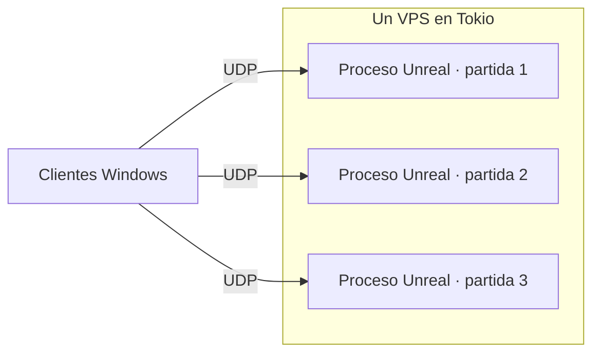

# 056 — Paso 7: servidor dedicado y alojamiento

## Resultado — 2026-10-27

El usuario eligió servidor dedicado para una demo privada de portafolio, con jugadores en Japón y alojamiento durante unos meses. El objetivo es coste bajo, infraestructura sencilla y hasta dos o tres partidas simultáneas, sin desarrollar ni desplegar un servicio adicional para gestionar salas. Se acordaron equipos con bots, ready e inicio por creador, revancha con salida tras 30 s sin respuesta, continuidad al desconectar con control temporal de bot y reconexión con estadísticas conservadas. El rol de organizador pasa al humano conectado más antiguo si el creador sale. Se prefieren proveedores globales conocidos; no es requisito usar uno local japonés. La integración todavía no está implementada.

Cloudflare puede conservar DNS y servicios web, pero Containers no admite el tráfico entrante nativo requerido por Unreal. La recomendación de despliegue es una VM cercana a los jugadores, preferentemente Tokio, con un proceso Unreal por partida y capacidad máxima acotada. Windows cliente/Linux servidor es la combinación recomendada; el proveedor y tamaño finales siguen pendientes de medición/elección.

No hubo cambios de código, configuración ni assets. Se agrega este análisis, su [guía](editor.md) y enlaces desde el índice y 055. No se aprovisionaron servicios, modificó DNS, compiló el motor ni desplegó el proyecto. Las etapas 0–6 siguen cerradas según [055](../055-selector-executioner/reporte.md).

## Viabilidad de Cloudflare

La documentación consultada el 2026-10-27 distingue estas funciones:

| Opción | Encaje con esta entrega |
|---|---|
| Cloudflare Containers | Ejecuta imágenes, pero sus conexiones entrantes pasan por Workers; los clientes no pueden enviar TCP no HTTP ni UDP directamente al contenedor. Por esa limitación no aloja tal cual un servidor Unreal con su transporte nativo. [Arquitectura oficial](https://developers.cloudflare.com/containers/concepts/architecture/). |
| Cloudflare DNS | Puede resolver un subdominio de juego a la IP pública del VPS mediante DNS only. La conexión del juego va directamente al servidor y no recibe la protección del proxy HTTP de Cloudflare. [Estado del proxy](https://developers.cloudflare.com/dns/proxy-status/). |
| Proxy web habitual | Cubre protocolos/puertos web admitidos; no reemplaza un proxy para el UDP del juego. [Puertos y servicios](https://developers.cloudflare.com/fundamentals/reference/network-ports/). |
| Cloudflare Spectrum | Proxy TCP/UDP hacia un servidor de origen; no ejecuta la partida. UDP personalizado requiere Enterprise con complemento de pago. [Producto](https://developers.cloudflare.com/spectrum/) y [protocolos por plan](https://developers.cloudflare.com/spectrum/protocols-per-plan/). |
| VM de otro proveedor | Aloja el proceso del juego con endpoint UDP público. Por ejemplo, [Hetzner Cloud](https://docs.hetzner.com/cloud/servers/overview/) ofrece VM e IP pública añadida, y [AWS EC2](https://docs.aws.amazon.com/AWSEC2/latest/UserGuide/changing-security-group.html) permite reglas UDP personalizadas. Región y coste deben elegirse según jugadores y presupuesto. |

La conclusión para la primera entrega es usar un servidor dedicado Linux x86_64 en una VM con UDP público y mantener Cloudflare para DNS/web si se desea. Es una recomendación de despliegue, no una compra ni una configuración aprobada. No se propone cambiar el transporte del juego a WebSocket para adaptarlo a Containers.

La ruta de juego sería cliente Unreal → UDP → VM con servidor Unreal; el DNS de Cloudflare solo resuelve el nombre. Cada partida tiene una simulación autoritativa en su servidor; distribuir DNS o servicios web por la red de Cloudflare no decide por sí solo dónde debe correr esa simulación.

## Estado concreto del repositorio

Rutas propias bajo `Source/vamps/Public/` y `Source/vamps/Private/`, con árboles paralelos:

| Área | Evidencia actual | Trabajo de red necesario |
|---|---|---|
| `GameModes/VampsMatchGameMode` | StartPlay requiere el primer PlayerController/pawn, crea tres bots y mantiene cuatro puestos locales. Selector, plazos y estadísticas viven en GameMode. | Admitir conexiones sin exigir jugador al arrancar; gestionar alta/baja/asignación de humanos y bots mediante el ciclo de login. Separar autoridad de presentación. |
| Estado de partida | No hay clases propias de GameState/PlayerState. Participants, TeamScores, RoundPhase y bExecutionerSelected no tienen replicación propia. | Compartir fases, reloj, equipo, selección y estadísticas; mantener selección/preparación por participante según las reglas online elegidas. |
| `UI/VampsCombatTestHUD` | Consulta GetAuthGameMode para dibujar y para los clicks de selección/START/revancha. | Los clientes necesitan leer estado replicado y enviar sus solicitudes por un objeto que posean; no consultar la instancia del GameMode. |
| `Player/VampsPlayerController` / `AVampsCharacter` | Input llama directamente a RequestCombatAction y SetMobilityHeld; el personaje exige HasAuthority. | Entregar solicitudes al servidor, validarlas con su estado y comunicar aceptación/resultados. No aceptar daño o bajas calculados por clientes. |
| GAS y combate | ASC y atributos declaran replicación; GA_Attack/GA_Dash son ServerOnly. FVampsCombatState y selección no tienen replicación propia. | Integrar activación/presentación y estados observables. La replicación de atributos es una base parcial, no un ciclo multijugador completo. |
| Elegibilidad | CanEngageEnemy/CanHitCombatTarget consultan GameMode; si no existe modo de partida no aplican esa regla de equipos. | Dar a clientes la información de equipo/vida/partida necesaria para selección y HUD coherentes, conservando la validación autoritativa en servidor. |
| Armas, animación y movilidad | BeginPlay inicializa armas y valores; hay trazas por sockets/notifies, root motion de dash y desplazamiento programado propio. | Separar escrituras autoritativas y presentación, evitar armas duplicadas y verificar contactos/root motion sin render. Adaptar movimiento a corrección/predicción de clientes sin replicar solo el transform final. |
| Cámara de espera | VampsMatchPlayerController consulta el GameMode para su control de cámara libre. | Decidir su estado desde información replicada; cámara, fade y encuadre siguen locales a cada cliente. |
| Build | Solo existen targets Game y Editor. vars.bat usa una instalación UE 5.8 con Engine/Build/InstalledBuild.txt. No hay target Server ni pipeline de empaquetado dedicado. | Preparar build del motor/proyecto apto para Server, contenido cocinado y plataforma de despliegue, además de los clientes. |

Epic documenta que GameMode existe solo en servidor y que GameState se replica a los clientes; también dispone de tiempo de servidor sincronizado para los contadores. Es la separación adecuada para sacar al HUD de su dependencia local actual. [GameMode y GameState](https://dev.epicgames.com/documentation/en-us/unreal-engine/game-mode-and-game-state-in-unreal-engine).

El net driver IP estándar del motor instalado crea un socket NAME_DGram en `Engine/Plugins/Online/OnlineSubsystemUtils/Source/OnlineSubsystemUtils/Private/IpNetDriver.cpp`: es tráfico UDP. No se encontró una sustitución de NetDriver en Config. UDP Messaging del editor es otro sistema y no resuelve el transporte de la partida.

## Preparación de builds

La [ruta oficial de Epic para servidores dedicados](https://dev.epicgames.com/documentation/en-us/unreal-engine/setting-up-dedicated-servers-in-unreal-engine) requiere proyecto C++ con multijugador, build del motor desde fuentes, target Server y contenido cocinado. Un paquete dedicado es un proceso sin jugador local ni render; no es una instancia del editor abierta en el VPS. El proyecto actual no acredita ese pipeline. No se inició una descarga/build del motor como parte del análisis.

Para Linux hay que preparar el toolchain correspondiente y revisar los plugins/módulos habilitados para ese target. Los assets de animación necesarios para notifies, sockets y trazas siguen formando parte del servidor aunque no dibuje la escena. La configuración actual AlwaysTickPoseAndRefreshBones ayuda a esa ruta, pero no acredita todavía contactos correctos en un proceso dedicado empaquetado.

La guía de Epic usa Lyra como ejemplo de empaquetado; no se propone copiar sus clases o lógica. La implementación seguirá sobre las clases propias y las nativas permitidas por AGENTS.md.

### Comprobación local en Mac Apple Silicon

El usuario consulta si puede usar una Mac M1 Pro para ejecutar el servidor durante las comprobaciones. Es una opción viable a preparar: el motor instalado incluye Mac en UnrealPlatformClass.Server, en `Engine/Source/Programs/UnrealBuildTool/System/Utils.cs`, y Epic documenta [ejecutables nativos ARM64 en macOS](https://dev.epicgames.com/documentation/en-us/unreal-engine/supporting-universal-binaries-for-macos-in-unreal-engine). Esto acredita soporte de plataforma, no una compilación correcta del proyecto ni capacidad medida de esa máquina.

La ruta sería servidor nativo macOS ARM64 en la Mac y clientes Windows conectados por IP de la red local, con revisiones compatibles del mismo juego. Requiere preparar Unreal/Xcode compatibles, compilar el proyecto y revisar sus plugins para ese target; el paquete Linux x86_64 del VPS no se ejecuta directamente en macOS. No hace falta agregar virtualización ni servicios externos para esa comprobación. Los [requisitos de desarrollo de Epic](https://dev.epicgames.com/documentation/en-us/unreal-engine/macos-development-requirements-for-unreal-engine) son una referencia para preparar el entorno, no un dimensionamiento del servidor de este juego.

Para una sala pequeña, M1 Pro es una candidata razonable porque el dedicado no renderiza; la memoria disponible y el consumo real siguen sin verificar. No se garantiza capacidad para tres salas por el modelo del procesador. Esta opción agrega una build Mac; para comenzar con el menor trabajo de plataformas también se pueden ejecutar servidor y clientes en Windows. Ninguna de esas comprobaciones reemplaza la verificación final del paquete Linux destinado al VPS. No se accedió a la Mac ni se compiló o ejecutó allí el proyecto, y esta consulta no incorpora soporte de cliente Mac al alcance.

## Alcance acordado

La partida mantiene 2v2 con Executioner. Un selector simple permite elegir equipo A/B respetando dos puestos por equipo; al comenzar, los puestos humanos vacíos se cubren con bots. Eso permite hasta cuatro humanos sin fijar la entrega a dos humanos concretos. Para poder evaluar la demo sin otra persona, se recomienda admitir un solo humano y tres bots; ese mínimo todavía no fue elegido expresamente.

Cada humano marca ready y el creador de la sala solicita el comienzo. El creador es un organizador cliente; la simulación y la validación de sus permisos pertenecen al servidor dedicado. La regla recomendada es habilitar START cuando todos los humanos presentes estén listos, dejando bots preparados automáticamente. Cambiar equipo debe retirar ready para no empezar con una distribución distinta de la aceptada.

PLAY AGAIN expresa intención de jugar otra ronda y vuelve al flujo de selección/equipos/ready; quien no acepta abandona esa próxima ronda y los puestos vacíos se cubren con bots al iniciar. Quien no responde a revancha ni salir tiene **30 s** para decidir y luego queda excluido del siguiente ciclo. Ese plazo corresponde a decidir la revancha, no introduce por sí solo un límite para ready. Si el creador sale, su rol pasa al humano conectado más antiguo; el bot nunca recibe ese rol.

Durante una ronda solo puede entrar quien estaba conectado y vuelve de una desconexión. La ronda continúa y un bot controla temporalmente su personaje, conservando identidad de participante, equipo y estadísticas vigentes. Reconectar devuelve el control a ese jugador sin crear otra plaza ni restaurarla por coincidencia de nombre. La sustitución por bot durante la desconexión fue elegida expresamente por el usuario. Sigue por precisar el plazo de reserva de esa reconexión; la recomendación es conservarla mientras exista la ronda.

La identidad de reconexión debe estar vinculada a una credencial de sesión emitida por el servidor. Volver a conectar recupera el estado vigente, incluidas las consecuencias ocurridas durante la ausencia; no debe regalar vida, teletransportar al spawn ni borrar muertes como si fuera un nuevo inicio de ronda.

El traspaso requiere separar cambio de controlador de reinicio de combate: la ruta actual de AVampsAIController usa StopActions/ResetCombatState al cambiar posesión. No se debe reutilizar esa limpieza sin adaptar sus efectos sobre energía, guardia, acciones y estadísticas durante la reconexión.

Las partidas son privadas. Dirección/subdominio más código de sala o un selector de salas privadas es una opción de acceso sencilla para acordar; no se ha pedido integrar cuentas, Steam/EOS ni matchmaking público.

## Varias partidas y servicio persistente

La arquitectura recomendada para este proyecto es **una partida por proceso Unreal**, con hasta tres procesos en **un mismo VPS**, no tres VPS. Cada proceso simula su mapa, personajes, animaciones necesarias, colisiones, bots y combate, y escucha en su propio puerto. No se propone mezclar tres UWorld y sus reglas dentro del mismo proceso actual.

El servicio del sistema mantiene ejecutables y los puede reiniciar; la simulación se ejecuta dentro de esos procesos. Mantener disponible el servicio no evita el coste de simular cada ronda activa. Dos o tres rondas simultáneas suman carga de CPU/memoria y requieren medir el caso conjunto.

Para esta escala se recomienda un menú con hasta tres botones fijos: Sala 1, Sala 2 y Sala 3. Cada botón conecta directamente al endpoint configurado para ese proceso Unreal. No se requiere consulta previa de disponibilidad, búsqueda automática ni reserva de instancias libres. El propio servidor del juego admite al participante en su sala o rechaza el ingreso con el motivo correspondiente si está llena o la ronda ya comenzó; durante la ronda sigue permitida la reconexión acordada. Si el servidor no responde, el cliente informa el fallo de conexión. El primer humano que entra en una sala vacía asume la organización. Este menú es la simplificación recomendada, todavía sin implementar.

La gestión de equipo, ready, permisos de inicio, reconexión y acceso privado pertenece al propio servidor Unreal. No se escribirá ni desplegará otro backend, registro de salas ni servicio de aprovisionamiento. Las unidades systemd son archivos de configuración para arrancar y supervisar el mismo ejecutable del juego con distintos puertos; no son programas adicionales. La forma final de acceso privado sigue abierta y debe validarla el servidor del juego.

Los procesos pueden permanecer levantados esperando jugadores y volver a sala vacía al terminar el ciclo. Un servicio como [systemd](https://www.freedesktop.org/software/systemd/man/latest/systemd.service.html) cubre arranque y reinicio. Esta propuesta evita necesitar aprovisionamiento de nuevas máquinas por partida; no incluye recuperación de una ronda tras caída del proceso o del VPS. La reconexión solicitada corresponde a un cliente que vuelve a la ronda todavía existente.

## Compensación acotada: recomendación técnica

El usuario pide contemplar la latencia, con tolerancia pequeña y sin un netcode demasiado complejo. No se eligió todavía el parámetro ni mecanismo final. Para Japón conviene ubicar primero el servidor cerca y medir RTT real; vivir en el mismo país no garantiza un ping concreto.

La propuesta es conservar autoridad del servidor, reutilizar la predicción/corrección de movimiento de CharacterMovement e integrar correctamente dash y desplazamientos propios. La respuesta visual local puede anticipar acciones sin adjudicar daño, bloqueo ni puntuación. Epic explica estas responsabilidades en [movimiento en red](https://dev.epicgames.com/documentation/unreal-engine/understanding-networked-movement-in-the-character-movement-component-for-unreal-engine) y en sus [buenas prácticas de habilidades de movimiento](https://dev.epicgames.com/community/learning/tutorials/ywD1/unreal-engine-best-practices-for-networked-movement-abilities).

Para defensa se recomienda explorar un buffer corto de resolución con límite inicial de **50 ms**, sujeto a acuerdo y observación. Se conservaría un historial mínimo del contexto defensivo y el tiempo de la petición, validado contra reloj/latencia observados por servidor. No se aceptaría sin control el timestamp aportado por el cliente ni se aumentaría la duración normal de guardia para ocultar el retraso.

Un input pulsado antes del contacto pero recibido después no puede cambiar un daño ya definitivo sin rehacer consecuencias. El buffer propone aplazar brevemente esa confirmación para admitir solo peticiones válidas dentro del límite; añade ese pequeño retraso a los resultados. No representa rollback general de posiciones, armas o mundo ni garantiza todas las ventajas de uno. Los valores de 50 ms son una propuesta de calibración, no una medición del entorno ni una regla ya aprobada.

Esta adaptación requiere cuidado en este juego: RMB es contextual, defensa puede cancelar ofensiva y el resolver conserva lotes por frame. La admisión debe respetar fase, NA, muerte, identidad ofensiva y orden temporal; no basta con retocar DefenseRequestEndsAt. Tampoco se deben fusionar todos los contactos del buffer en un único lote ni permitir que una pulsación posterior al contacto se convierta por defecto en bloqueo. La implementación debe concretar esas consecuencias antes de marcar la compensación como hecha.

## Hosting en Japón y coste

Precios de referencia consultados el 2026-10-27; no equivalen a un dimensionamiento aprobado:

| Candidato | Plan de referencia | Precio mensual publicado |
|---|---|---|
| Akamai/Linode Shared CPU | 2 CPU, 4 GB RAM | 24 USD de catálogo; confirmar región, disponibilidad e impuestos. |
| Akamai/Linode Shared CPU | 4 CPU, 8 GB RAM | 48 USD de catálogo; confirmar región, disponibilidad e impuestos. |
| Sakura VPS, Tokio | 4 cores virtuales, 4 GB RAM | 3960 JPY, pago mensual e impuestos incluidos. |
| Sakura VPS, Tokio | 6 cores virtuales, 8 GB RAM | 7920 JPY, pago mensual e impuestos incluidos. |

Fuentes: [precios CPU Akamai](https://www.akamai.com/cloud/pricing/cpu), [regiones Tokio en documentación Akamai](https://techdocs.akamai.com/cloud-computing/docs/images) y [especificaciones/precios Sakura](https://vps.sakura.ad.jp/specification/). Los precios Sakura de esta tabla son mensuales, no el equivalente mensual de un compromiso anual. No se ha elegido proveedor ni contratado un plan.

El usuario precisó que no necesita un proveedor local y prioriza simplicidad. **Linode/Akamai** es la recomendación global inicial: su [lista oficial de disponibilidad](https://www.akamai.com/why-akamai/global-infrastructure/availability) incluye Tokio. El plan de 4 GB/2 CPU a 24 USD y el de 8 GB/4 CPU a 48 USD de catálogo son candidatos a medir; no se garantiza capacidad para tres partidas ni disponibilidad de una generación concreta antes de contratar.

**DigitalOcean** ofrece VM administrables con un esquema semejante, pero su [lista oficial de regiones](https://docs.digitalocean.com/platform/regional-availability/), verificada por el proveedor el 2026-10-09, no incluye Tokio. Incluye Singapur; usarlo sería una elección explícita de esa región con medición de latencia desde Japón. No se asume una región japonesa por tratarse de un proveedor conocido.

Como contraste, [Lightsail](https://aws.amazon.com/lightsail/pricing/) publica 4 GB/2 vCPU por 24 USD y 8 GB/2 vCPU por 44 USD con IPv4; [Tokio es región admitida](https://docs.aws.amazon.com/lightsail/latest/userguide/understanding-regions-and-availability-zones-in-amazon-lightsail.html). Hay que contemplar su [rendimiento base y capacidad de ráfaga](https://docs.aws.amazon.com/lightsail/latest/userguide/amazon-lightsail-viewing-instance-burst-capacity.html) al evaluar simulaciones sostenidas, no decidir solo por RAM.

La configuración de infraestructura propuesta consiste en una VM Linux, ejecutable empaquetado, hasta tres unidades de servicio del sistema, puertos de juego definidos y DNS opcional. El cliente conecta mediante botones con endpoints fijos; toda la gestión de cada sala ocurre dentro de su proceso Unreal. No requiere otro backend, base de datos administrada, balanceador ni orquestación de una flota para este alcance. La herramienta de despliegue se elige por esa sencillez; no se añade un contenedor solo por usar cloud.

Para gastar lo mínimo se recomienda medir primero tres procesos empaquetados en la misma máquina: memoria total, uso de CPU, tiempos de tick y continuidad del juego con dos o tres rondas activas. Una VM de 4 GB es candidata económica solo si supera ese caso; 8 GB y alrededor de cuatro vCPU dan un siguiente escalón para evaluar, sin garantía de capacidad antes de medir. CPU virtual compartida no equivale a un core físico reservado.

La contratación debe ser mensual para unos meses de disponibilidad, con coste total previsto y límite de tres salas. El objetivo es que el candidato de menor coste mantenga la demo fluida, no limitar recursos por una cifra sin medir. CPU, tick rate, puertos auxiliares y capacidad final siguen pendientes de la build y esa observación manual. Cloudflare conserva su posible función de DNS/web y no necesita Spectrum para la conexión directa propuesta.

## Verificaciones y límites

Se revisaron targets, Build.cs, configuración, GameMode, controller, HUD, personaje, GAS, selección, movilidad y armas. Las fuentes externas son documentación oficial consultada en esta fecha; la restricción de Containers y los planes Spectrum son capacidades actuales que deben revalidarse al contratar/desplegar.

No se releyeron assets por MCP ni se ejecutaron compilaciones, PIE, servidores, herramientas de nube o tests automatizados. No se automatizó la UI. No se modificaron DA ni sus tipos; cualquier implementación que lo haga deberá capturar/preservar los assets afectados antes de editar/compilar según AGENTS.md. La [guía](editor.md) separa decisiones, preparación y futura comprobación manual.

## Preguntas antes de implementar

1. **Reconexión:** ¿se reserva la identidad y plaza hasta terminar la ronda? El control temporal por bot ya está elegido; no se debe volver a preguntar si el personaje queda inmóvil.
2. **Inicio:** ¿se admite un humano con tres bots y START exige ready a todos los humanos presentes? Es la recomendación para que la demo se pueda evaluar sin coordinar otras personas. Transferencia de organizador y plazo de 30 s para decidir revancha ya están elegidos.
3. **Despliegue y compensación:** ¿se adopta la propuesta Windows cliente/Linux x86_64 servidor y hasta tres salas fijas en una VM, con botones de conexión directa sin búsqueda/reserva automática? ¿Qué credencial valida el acceso privado dentro del servidor Unreal? ¿Se acepta explorar el buffer defensivo con tope inicial de 50 ms y su breve retraso de confirmación? No se agregará un servicio aparte para gestionar salas. Proveedor/plan y techo de gasto finales se eligen tras medir; la recomendación global inicial es Linode/Akamai Tokio y Lightsail es otra alternativa.

El alcance funcional principal ya está elegido. No hace falta diseñar skins, segundo personaje, progresión persistente, ranked ni una flota autoscalable. La preparación del build del motor desde fuentes indicada arriba sigue siendo un requisito técnico para el pipeline dedicado, no una función adicional del juego.
